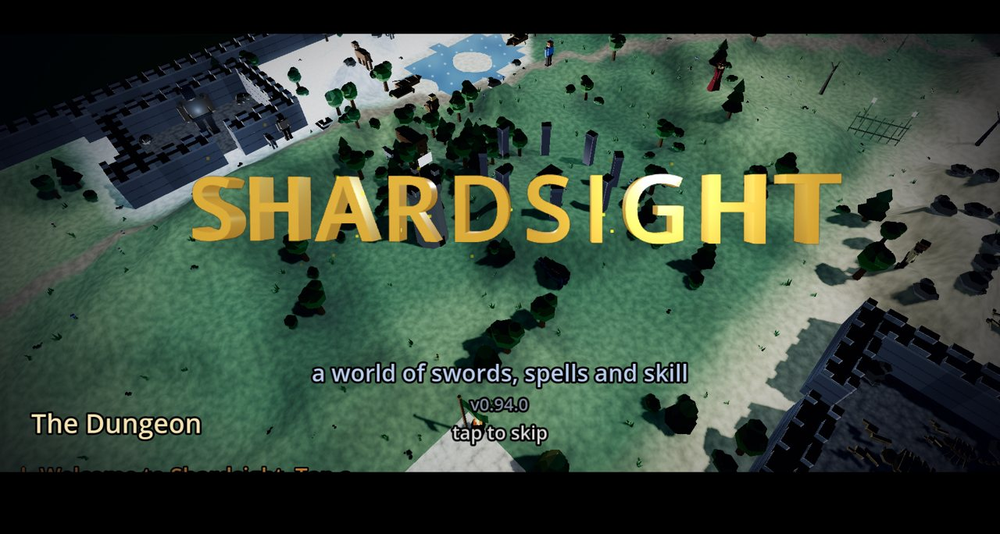
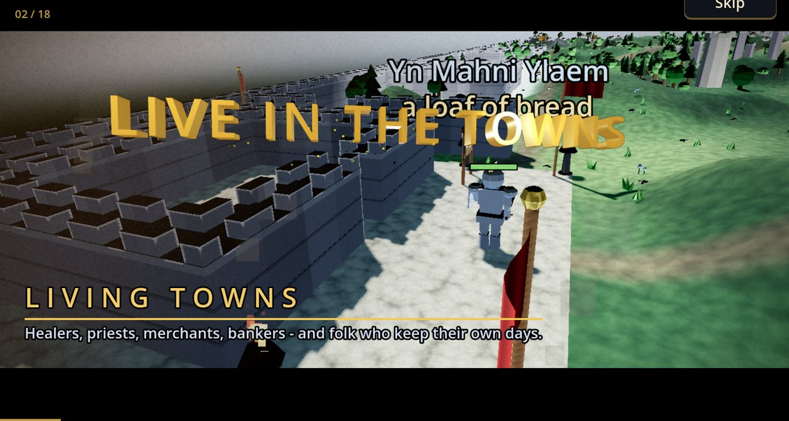
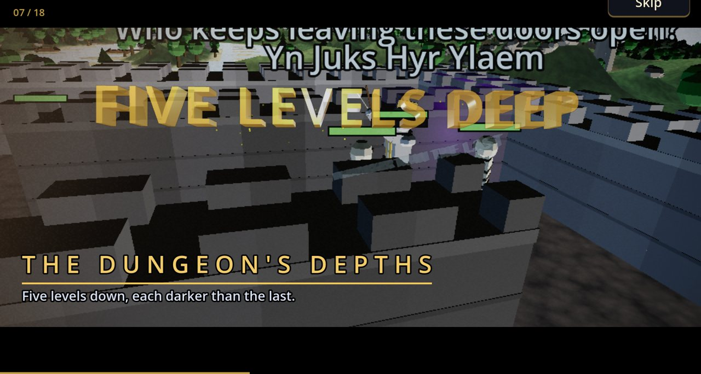
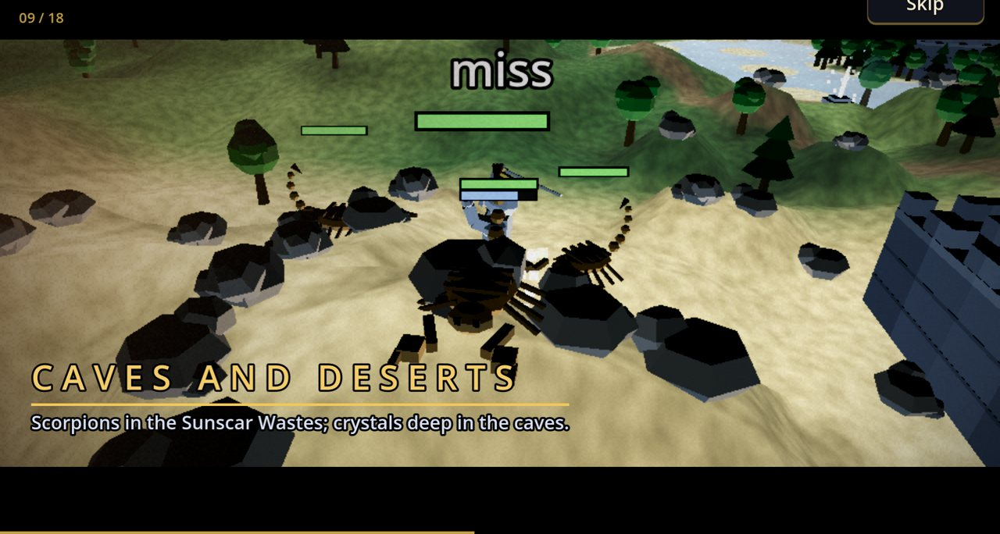
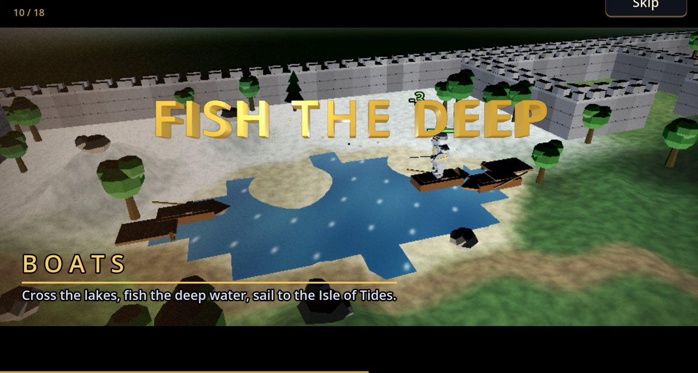
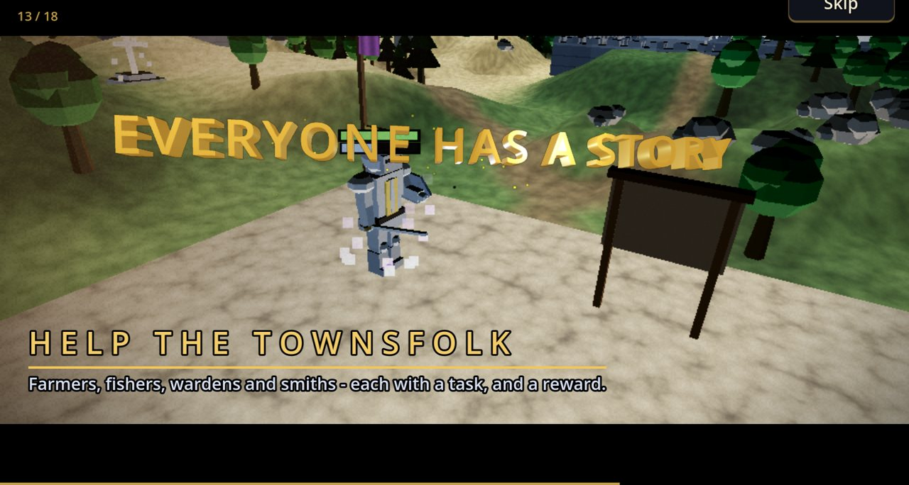
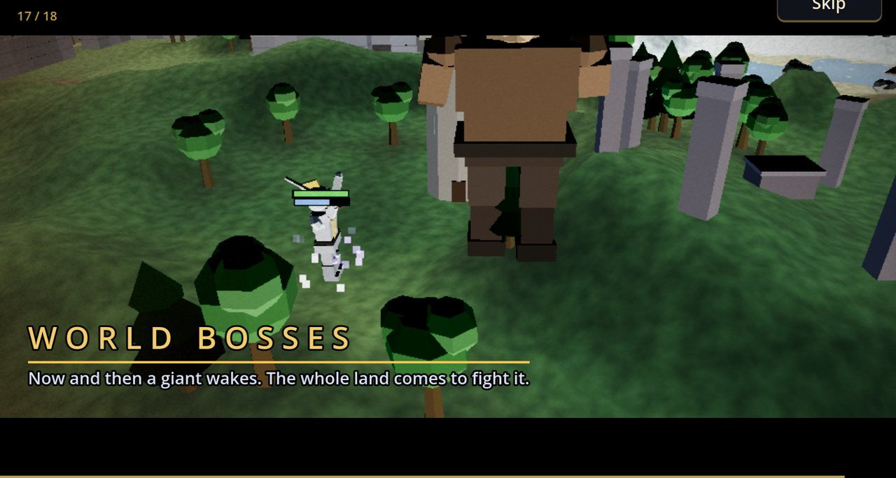
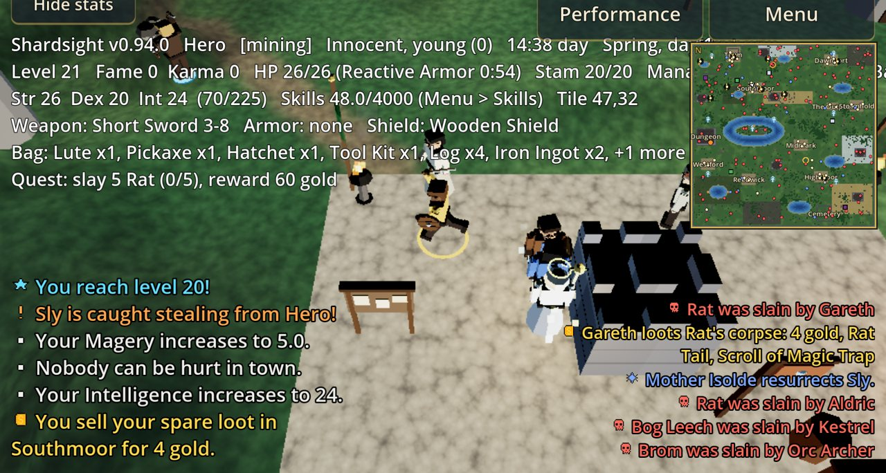

# ✦ SHARDSIGHT ✦

### *A world of swords, spells and skill — in your pocket.*

A living 3D fantasy world for Android, in the spirit of the classic online RPGs:
no classes, just you, what you practise, and a land that goes on without you.

**[⬇ Download the latest APK](https://github.com/luckovsdeniss-denlu/Shardsight/releases/latest)** ·
**[▶ Trailer](https://github.com/luckovsdeniss-denlu/Shardsight/releases/download/trailer/shardsight-trailer.mp4)** ·
**[▶ Trailer 2 — the long flight](https://github.com/luckovsdeniss-denlu/Shardsight/releases/download/trailer/shardsight-trailer-2.mp4)**

---

## You wake on the road with no memory

Something you once saw has been taken from you. In a church far to the south-west, an old priest
knows more than he says. Between you and the answer lies a whole world: nine towns, a dungeon five
levels deep, frozen peaks and burning ash, haunted graveyards, an island across the sea — and
hundreds of creatures, adventurers and townsfolk living their own lives around you.

**This is *The Shattered Sight*. Where you go from here is up to you.**

## Become what you do

There are no classes. Swing a sword and you get better with swords. Cast spells and your Magery
grows. Chop, mine, fish, cook, brew, tame, steal, play the lute — every skill rises with use, from
novice to grandmaster, and what you become is simply the sum of what you've done.

- ⚔️ **Fight your way** — swords, axes, maces, spears, bows and crossbows, each with its own blow,
  critical hits and special moves. Parry, bleed, crush, poison your blade.
- ✨ **Speak the old words** — **67 spells in eight circles**, from a spark of light to meteor swarms,
  summoned elementals, curses, fields of fire, resurrection and travel by rune and gate.
- 🛠 **Make your own way** — mine ore and smelt it, forge weapons and armour, cook hearty meals,
  brew potions and poisons, enchant your gear and set gems in it.
- 🐎 **Tame the wild** — horses, llamas, ostards, beetles and swamp dragons to ride; pets that fight
  beside you and grow with you.

## A world that lives without you

- 🏰 **Nine towns** spread over a vast 144×144 land, each with healers, merchants, bankers, priests and
  a bounty board — and townsfolk who keep their own days: work at dawn, the tavern at dusk, home at night.
- 🗺 **Eight wild regions** — the Frostmarch and the Whitepeaks, the Sunscar Wastes and the Dunes of
  Kesh, the Blackwater Fen and the Reedmarsh, the Ashlands and the Cinderfields — each with its own beasts.
- 🕳 **Caves and a dungeon** — six caves with their chiefs, and a dungeon that goes **five levels down**,
  each darker than the last, each with its own boss.
- ⛵ **Boats** — row across the lakes, fish the deep water, sail to the Isle of Tides and the
  Drowned King who rules it.
- 🪦 **Ravenhollow Cemetery** — the restless dead, cold wisps at night, and a tomb that should stay shut.
- 🐉 **World bosses** — now and then a giant wakes, and the whole land comes to fight it.
- 🛡 **Guilds and towers** — join a guild, fight its wars, and hold the towers for their tolls.
- 🏟 **The Arena** — fight champions for the purse, and bet on yourself. Then race horses round the track.
- 🍂 **Seasons, weather and day** — spring to winter, rain, snow and storms, and nights where the dead
  rise in the wilds. Sow your fields, and watch them grow with the seasons.
- 📜 **Quests and bounties** — a main story, side quests from the townsfolk, and named beasts with a
  price on their head.
- 🏠 **A house of your own** — buy a deed, build it, furnish it, and keep your gold in the bank.

## Or let your hero live it

Tap **Auto** and your hero plays on their own — fighting, looting, crafting, questing, travelling,
taking on the arena and the world bosses — balancing everything the world offers. Watch them grow,
or take over at any moment.

## Made entirely in code

Every mountain, tree, castle and creature is built from code at start-up — **no art files**. Every
sound effect and every piece of music is **synthesised on the fly** — no audio files either: lutes,
flutes, brass, choir, drums and bells written into sixteen-bar pieces for each place and mood.

- 🎬 Two in-game trailers — a cinematic showcase, and one unbroken camera flight across the whole land —
  with 3D titles, flying words, an epic score and cartoon-crunchy fights.
- 📈 A frame-rate keeper that holds **60 fps** by itself, with a Performance panel to take control.
- 📱 Built for phones: Godot 4.3, GL Compatibility renderer, one APK.

## Screenshots

| | |
|---|---|
|  |  |
|  |  |
|  |  |

## Get it

1. Open **[the latest release](https://github.com/luckovsdeniss-denlu/Shardsight/releases/latest)** on your Android phone.
2. Download the `.apk` and open it (allow installing from your browser if asked).
3. Choose **Play**, **Tutorial**, or watch a **Trailer** first.

## For developers

Open the folder in Godot 4.3 and press Play. Everything lives in `scripts/`:

| Script | What it holds |
|---|---|
| `main.gd` | the game: camera, world spawning, interface, saving, performance |
| `world.gd` | the map, biomes, caves, towns, roads; pathfinding; building the 3D land |
| `entity.gd` | every creature: AI, movement, combat, magic, animation |
| `frontier.gd` | towers, docks, the tavern, arena, church, cemetery, seasons, farming, world bosses, Auto |
| `movie.gd`, `title3d.gd` | the two trailers and the 3D titles |
| `music.gd`, `sfx.gd`, `soundscape.gd` | the procedural score, sound effects and mix |
| `spells.gd`, `gear.gd`, `items.gd`, `crafting.gd`, `bestiary.gd` | the game's tables |

Builds are made by GitHub Actions (`android-apk.yml`) and published to Releases as `v<version>`;
`trailer-video.yml` records the trailers to video. What changed when is in [CHANGELOG.md](CHANGELOG.md).
